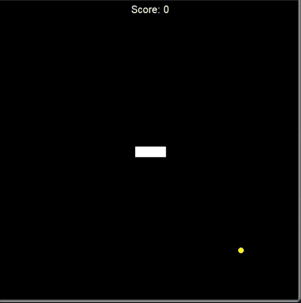

# Day 21 - Build the Snake Game Part 2: Inheritance & List Slicing

## Concepts Practised
- Extending classes through inheritance
- Managing collections of Turtle objects
- Using list slicing to move the snake's segments
- Detecting collisions with food, walls, and the snake's body
- Updating a scoreboard and handling game-over conditions

## Snake Game Part 2
Complete the Snake game with food, a growing snake, score tracking, and collision detection. Use the **W**, **A**, **S**, and **D** keys to control the snake.

[Open the Snake Game Part 2 project](./snake-game-final/)
