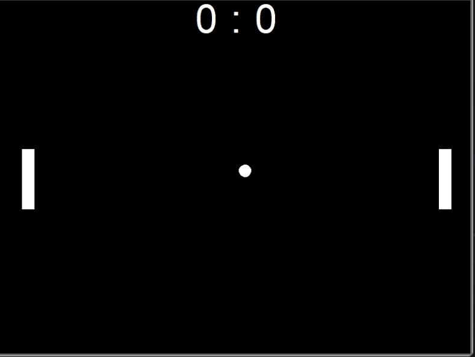

# Day 22 - Build Pong: The Famous Arcade Game

## Concepts Practised
- Building a multi-object game with Turtle graphics
- Creating and controlling paddles
- Moving a ball and detecting collisions
- Keeping and updating a score
- Dividing game logic into reusable classes

## Pong Game
Recreate the classic Pong arcade game with two paddles and a moving ball. Control the left paddle with `W` and `S`, and the right paddle with the `Up` and `Down` arrow keys.

[Open the Pong project](./The%20Pong%20Game/)
