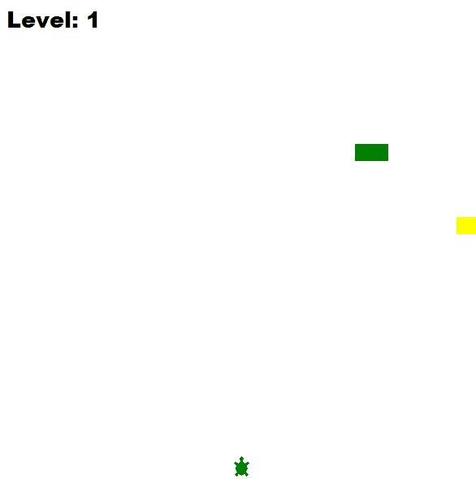

# Day 23 - The Turtle Crossing Capstone Project

## Concepts Practised
- Object-oriented Turtle graphics
- Creating and moving a player across the screen
- Generating and moving random traffic
- Detecting collisions between objects
- Tracking progress with a score level
- Increasing difficulty as the player advances

## Turtle Crossing Game
Help the turtle cross the road without colliding with moving cars. The player advances upward with the `W` arrow key and earns a level increase after reaching the finish line.

[Open the Turtle Crossing project](./turtle-crossing/)
